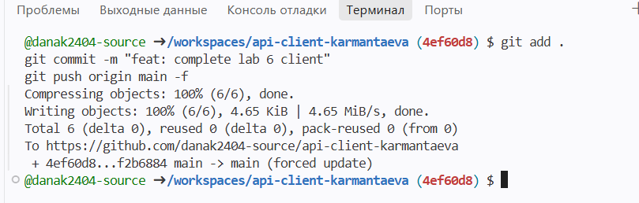

# api-client-karmantaeva
# API Client — Lab 6

## Автор
**Имя:** Дана Кармантаева (Karmantaeva Dana)  
**Группа:** IT1-2310  
**Репозиторий:** https://github.com/danak2404-source/api-client-karmantaeva

---

## Использованный API
- **Название:** JSONPlaceholder
- **Base URL:** `https://jsonplaceholder.typicode.com`

---

## Как открыть проект и запустить
1. Откройте файл `index.html` в браузере через GitHub Pages или локально.
2. Интерфейс позволяет загружать посты, искать их по ID пользователя с передачей query-параметра, просматривать детали конкретного поста и выполнять параллельные запросы через `Promise.all`.

---

## Что делает await и зачем проверять response.ok

Ключевое слово `await` приостанавливает выполнение асинхронной функции до тех пор, пока Promise не перейдет в состояние `resolved` (успешно выполнится), возвращая готовый результат. Проверка свойства `response.ok` необходима потому, что метод `fetch` выбрасывает ошибку (исключение) только при сетевых сбоях, но не при HTTP-ошибках вроде 404 или 500; `response.ok` возвращает `true` только для успешных кодов ответа в диапазоне 200–299, что позволяет вовремя перехватить некорректный ответ сервера в блоке `try/catch`.

---

## Скриншот страницы

---